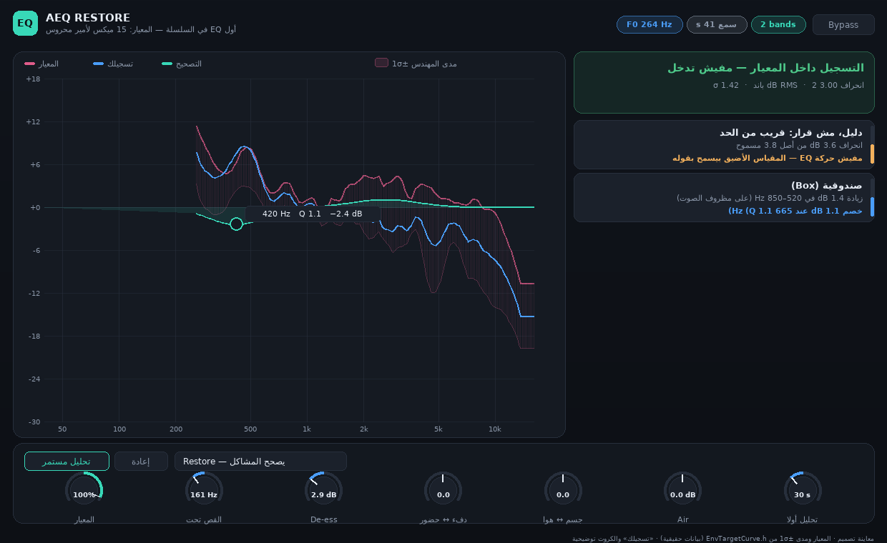

# 15 — الواجهة: الشكل، واللي فيها، واللي لسه ناقص

> سؤالك: **«الأداة شكلها بدائي جداً، فين الشكل العصري؟ وهل فيها كل اللي طلبناه؟»**
>
> الوثيقة دي بتجاوب على الاتنين بصراحة: الأول **إيه اللي كان بدائي فعلاً وبقى إيه**
> (مع معاينة بالصورة)، وبعدها **جدول محاسبة**: كل حاجة اتطلبت، وحالتها الحقيقية.

---

## 1. ليه كانت بدائية — مش ذوق، نقص

الواجهة القديمة كانت **38 سطر** في `PluginEditor.h`: 7 سلايدرز أفقية بـJUCE الافتراضي،
زرين، و3 أسطر نص. يعني:

| العيب | إحساسه للمستخدم |
|---|---|
| سلايدرز أفقية بأسماء إنجليزي (`Warm / Presence`, `Body / Air`) | شكل أداة تجريبية |
| مفيش تعامل مع الكيرف: الكيرف بيتفرّج عليه بس | **مش EQ** — الـEQ بيتسحب |
| مفيش مدى سماحية مرسوم | مش فاهم ليه البلجن "مش بيعمل حاجة" |
| المشاكل 3 سطور نص على شاشة 880×560 | صعب تقرا وتفهم وأنت بتشتغل |
| مقاس ثابت، مفيش تكبير | مش مريح على شاشة كبيرة |
| مفيش رسالة واحدة تجاوب: "ألمسه ولا أسيبه؟" | أهم سؤال في الأداة كان بيضيع |

---

## 2. الواجهة الجديدة (معاينة)

> المعاينة دي **رسم تصميم** من `analysis/scripts/ui_preview.py`، مش صورة من البرنامج.
> اللي **حقيقي** فيها: منحنى المعيار ومدى ±1σ — بيقروا من `EnvTargetCurve.h` نفسه اللي
> البلجن بيترجمه (بوابة G20). اللي توضيحي: منحنى «تسجيلك» والكروت.

### 2.1 الطبقات الأربعة

**١. الهيدر** — الهوية، وشريط أرقام حيّ: `F0 264 Hz` · `سمع 41 s` · `2 bands` ·
`Bypass`. يعني تعرف حالة البلجن من غير ما تقرا سطر.

**٢. الكيرف** — أربع حاجات مرسومة مع بعض:
- **مدى المهندس ±1σ**: شريط وردي فاتح حوالين المعيار — ده **تشتت أمير محروس نفسه**
  على الـ15 ميكس. الكيرف جوه الشريط ده = **جوه مداه**، ومافيش حاجة تتعمل. دي أهم
  فكرة في التصميم كله، وبقت **مرسومة** بدل ما تكون ادعاء في نص.
- **المعيار** (خط وردي)، **تسجيلك** (أزرق)، **المظروف** (أخضر متقطع)، **التصحيح**
  (أخضر متصل بمنطقة مظللة).
- **هاندل لكل باند بيتسحب بالماوس** — تحرّك تصحيح البلجن بإيدك: أعلى/أوطى،
  دبل كليك يرجّعه. (البوابة G18 بتتأكد إن السحب بيغيّر التطبيق ومابيلمسش القياس.)
- **كريسر** بيعرض التردد تحت الماوس، وعلامة على كل مشكلة مكتشفة.

**٣. التقرير** — كل مشكلة في **كارت**: الاسم بالعربي، الرقم اللي أثبتها، والقرار
(أو سبب إن مفيش قرار). الشرائط الجانبية ملوّنة بالخطورة. وفوقهم **كارت الحكم**:
> «التسجيل داخل المعيار — مفيش تدخّل» + انحراف dB RMS + عدد الباندات + σ

**٤. شريط التحكم** — 7 كنوبز مرسومة (قوس ملوّن من المركز: boost/cut باين من الشكل)،
تحليل مستمر، إعادة، واختيار الوضع.

**بالإضافة:** المقاس بقى **قابل للتكبير** (980×640 → 1900×1200)، خطوط عربية بتشكيل
صحيح (JUCE 8 بيستخدم HarfBuzz)، وألوان موحّدة في `ui/Theme.h`.

---

## 3. جدول المحاسبة: كل حاجة اتطلبت وحالتها

| # | الطلب | الحالة | الدليل |
|---|---|---|---|
| 1 | `.exe` واحد، Next/Next | ✅ | `docs/12` §7، Releases |
| 2 | VST3 + Standalone | ✅ | نفس المصدر |
| 3 | نقدّر ننزّل التعديلات | ✅ | Releases تلقائي من CI |
| 4 | يشتغل على **الأداء كله** | ✅ | تحليل مستمر في البلجن، والقرار بعد settle |
| 5 | هدف = **15 ميكس أمير** | ✅ | `EnvTargetCurve.h` من الـ15 |
| 6 | السماحية = **تشتت المهندس** | ✅ ومرسومة | مدى ±1σ في الكيرف |
| 7 | قرار **"مش هلمس"** بالأرقام | ✅ | كارت الحكم + `audit_decisions.py` (0/15 إنذار) |
| 8 | المظروف الهرموني | ✅ | `docs/14` §8–9 |
| 9 | «التخنة» مقاسة | ✅ (كانت 0/15) | §9.1 |
| 10 | **كيرف الـEQ** (أهم حاجة عندك) | ✅ لكن **للعرض/التعديل فقط** | ترسم وتسحب؛ **مفيش EQ يدوي كامل** ⬜ |
| 11 | تسمع التشابات (timbre) | 🟡 جزئي | بالـσ والانحراف؛ **مفيش تحليل طبقة صوت مفصّل** ⬜ |
| 12 | «مفيش منه في العالم» | 🟡 | ✓ قدرات 1–6 و8 من `docs/13`؛ ✗ مفيش A/B ولا دليل مصدَّر ⬜ |
| 13 | واجهة عصرية | ✅ المرحلة الأولى | المعاينة فوق؛ **التنفيذ لسه ما اتبناش على ويندوز** 🟡 |
| 14 | Presets / A/B / Undo | ⬜ **مفيش** | — |
| 15 | تحليل باند لكل باند بصراحة | 🟡 | σ معروض؛ القرار لسه على مستوى المنطقة |
| 16 | أرضية الكشف < 4 dB | ⬜ | محتاج مراجع أكتر من 15 (`docs/14` §9.4) |

### الحاجات اللي **مش** موجودة ولازم تتقال

1. **مفيش EQ يدوي حر.** عندك 5–6 باندات البلجن قترحها + تعديل على اللي قترحه.
   مش تقدر تضيف باند من عندك ولا تغيّر نوعه (shelf/bell) ولا الـQ.
2. **مفيش Presets ولا A/B ولا Undo.** الـA/B من طبقة الـDAW مش من الأداة.
3. **مفيش تحليل طبقة صوت** (bright/dark/warm/breathy) كنِسَب مقاسة — اللي موجود
   محورين ذوق (دفء↔حضور، جسم↔هوا).
4. **المعاينة مش صورة من البرنامج.** الشكل اللي تحت هيتبني على ويندوز في الـCI،
   وأول ما يطلع أخد لك صورة حقيقية منه.
5. **مفيش صور/أيقونة مخصصة** — الأيقونة الحالية بسيطة.

---

## 4. اللي اتحسن في الكود نفسه

| الملف | إيه فيه |
|---|---|
| `plugin/Source/ui/Theme.h` | لوحة ألوان وخطوط وكروت وشيبس — مصدر واحد للشكل |
| `plugin/Source/ui/CurveView.h` | الكيرف: المدى، المعيار، تسجيلك، المظروف، التصحيح، الهاندلز، الكريسر |
| `plugin/Source/ui/ProblemList.h` | التقرير ككروت مع شريط خطورة وقرار |
| `plugin/Source/PluginEditor.cpp` | اللوك-أند-فيل (كنوبز/أزرار/كومبو)، التخطيط، الهيدر، كارت الحكم |
| `RestoreCore::setBandTrim` | الـtrim بيتطبق على الكاسكيد ومابيغيّرش القياس |
| `plugin/check_ui_compile.sh` | فحص الكود على JUCE نضيف في **4 ثواني** بدل 6 دقايق CI |
| `analysis/scripts/ui_preview.py` | المعاينة من نفس الجدول اللي البلجن بيترجمه |

**البوابات: 17/17**، والاختبارات **27** تأكيد (منها G18: السحب بيغيّر التطبيق
ومابيلمسش القياس).
